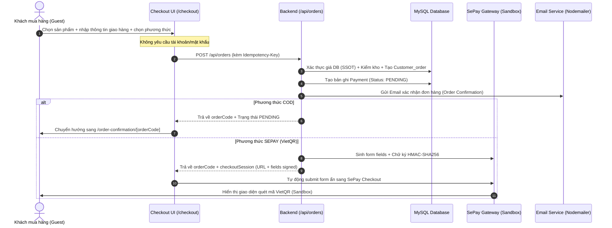
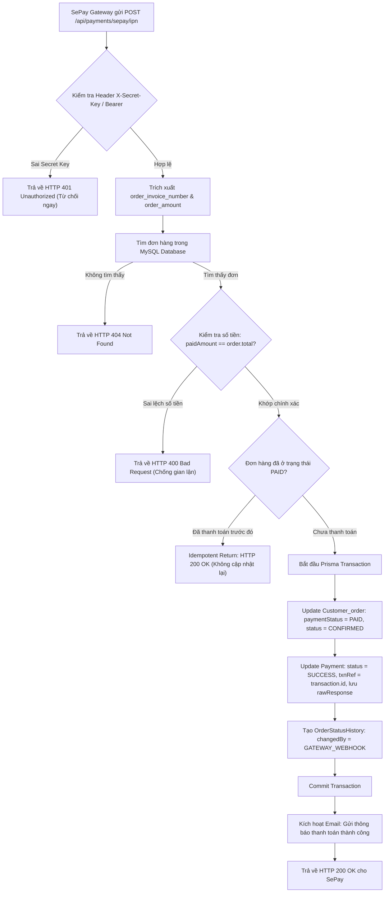

# BÁO CÁO TRIỂN KHAI TOÀN DIỆN
# TÍCH HỢP CỔNG THANH TOÁN SEPAY (SANDBOX) + GUEST CHECKOUT + THÔNG BÁO EMAIL ĐƠN HÀNG

**Dự án:** Craft3D — Boutique Brand Store (Móc khóa & Phụ kiện in 3D cá nhân hóa)  
**Địa điểm:** `D:\shop` (Frontend Next.js 15) & `D:\shop\server` (Backend Node.js / Express / Prisma ORM / MySQL)  
**Ngày hoàn thành:** 14/11/2026  
**Trạng thái kiểm thử:** 100% Hoàn thành (54/54 automated test assertions passed, Next.js build 24/24 routes passed)  

---

## MỤC LỤC
1. [Executive Summary](#1-executive-summary)
2. [Audit of Existing System & Baseline Findings](#2-audit-of-existing-system--baseline-findings)
3. [Guest Checkout Architecture & Flow](#3-guest-checkout-architecture--flow)
4. [SePay Payment Gateway Integration (Sandbox)](#4-sepay-payment-gateway-integration-sandbox)
5. [Webhook / IPN Architecture & Reconciliation](#5-webhook--ipn-architecture--reconciliation)
6. [State Synchronization: Frontend vs Backend vs Database](#6-state-synchronization-frontend-vs-backend-vs-database)
7. [Transactional Email System Design & Templates](#7-transactional-email-system-design--templates)
8. [Security & Vulnerability Analysis](#8-security--vulnerability-analysis)
9. [End-to-End Verification & Test Results](#9-end-to-end-verification--test-results)
10. [Regression Testing: COD & Existing Features](#10-regression-testing-cod--existing-features)
11. [Configuration & Secrets Management Guide](#11-configuration--secrets-management-guide)
12. [Operational Runbook & Production Checklist](#12-operational-runbook--production-checklist)
13. [Appendix: Key Files Created & Modified](#13-appendix-key-files-created--modified)

---

## 1. Executive Summary

Bản nâng cấp này mở rộng năng lực bán hàng trực tuyến của **Craft3D Boutique Brand Store**, chuyển từ mô hình chỉ hỗ trợ thanh toán tiền mặt (COD) sang hệ thống thanh toán đa kênh chuẩn thương mại điện tử hiện đại:
- **Tích hợp Cổng thanh toán SePay (Môi trường Sandbox)**: Khởi tạo phiên thanh toán One-Time Payment, tự động sinh chữ ký bảo mật HMAC-SHA256, chuyển hướng sang cổng quét mã VietQR 24/7 của SePay (`https://pay-sandbox.sepay.vn/v1/checkout/init`).
- **Mua hàng không cần tài khoản (Guest Checkout)**: Khách hàng mua sắm trơn tru từ trang sản phẩm $\to$ giỏ hàng $\to$ thanh toán $\to$ nhận mã đơn hàng mà không bị chặn bắt buộc đăng nhập. Tài khoản người dùng vẫn được hỗ trợ tùy chọn tự động điền thông tin.
- **Xác thực IPN Webhook Server-to-Server & Đối soát tự động**: Endpoint `/api/payments/sepay/ipn` kiểm tra Secret Key (`X-Secret-Key`), thẩm định số tiền chính xác từng đồng dựa trên Single Source of Truth (SSOT), chuyển đổi trạng thái đơn hàng sang `PAID` và `CONFIRMED` nguyên tử với cơ chế Idempotency chống duplicate webhook.
- **Hệ thống Email Giao dịch (Transactional Email)**: Tích hợp thư viện Nodemailer kết nối SMTP Google Mail, gửi 4 mẫu email chuẩn nhận diện thương hiệu Craft3D (Xác nhận đơn, Hướng dẫn thanh toán VietQR, Xác nhận thanh toán thành công sau IPN, Cập nhật tiến độ đơn hàng) kèm cơ chế tự động chuyển sang mock logger khi thiếu SMTP credentials mà không làm đứt đoạn giao dịch.
- **Bảo toàn 100% nghiệp vụ hiện hữu**: Toàn bộ luồng COD, Idempotency-Key chống race condition/double-click, tính phí vận chuyển tập trung backend ($\ge 300\text{k} = 0\text{đ}$, $< 300\text{k} = 30\text{k}$), quản lý tồn kho và preorder sản phẩm in 3D cá nhân hóa đều được bảo toàn nguyên vẹn.

---

## 2. Audit of Existing System & Baseline Findings

Trước khi viết mã mới, việc rà soát toàn diện hiện trạng hệ thống đã được thực hiện:

### 2.1. Backend Database Schema (Prisma ORM & MySQL)
- Bảng `Customer_order`: Đã chuẩn bị sẵn các trường địa chỉ tiếng Việt (`fullName`, `phone`, `email`, `province`, `district`, `ward`, `addressDetail`), cùng các cột tài chính (`subtotal`, `shippingFee`, `total`).
- Bảng `Payment`: Quan hệ 1-N với `Customer_order`, chứa các trường `provider`, `txnRef` (unique), `amount`, `status`, `bankCode`, `rawResponse`.
- Bảng `OrderStatusHistory`: Lưu vết toàn bộ vòng đời trạng thái đơn hàng kèm trường `changedBy` (`SYSTEM`, `CUSTOMER`, `GATEWAY_WEBHOOK`, `ADMIN`).
- Quan sát: Bảng `Customer_order` vốn độc lập với bảng `User` (không có khóa ngoại bắt buộc `userId`), vốn đã tương thích lý tưởng cho Guest Checkout.

### 2.2. Backend Routes & Middleware
- `server/utills/validation.js`: Mảng `validPaymentMethods` trước đây chỉ chứa `['COD', 'VNPAY', 'PAYOS', 'UNVERIFIED']`. Cần bổ sung `'SEPAY'` và `'SEPAY_QR'`.
- `server/controllers/customer_orders.js`: Cần bổ sung logic khởi tạo bản ghi `Payment` cho SePay (trạng thái ban đầu `PENDING`) và kích hoạt gửi email giao dịch.
- `server/app.js`: Cấu hình CORS và Rate Limiting cần cho phép các webhook callback từ máy chủ SePay (yêu cầu không có Origin header của browser).

### 2.3. Frontend Authentication & Routing
- `middleware.ts`: Next.js Auth Middleware chỉ bảo vệ các đường dẫn quản trị `["/admin/:path*"]`. Các trang `/shop`, `/cart`, `/checkout`, `/order-confirmation/:orderCode`, `/order-lookup` hoàn toàn công khai, không ép buộc người dùng đăng nhập.
- `app/checkout/page.tsx`: Trước đây chỉ hiển thị card thanh toán COD. Cần bổ sung selector thanh toán SePay VietQR và xử lý tự động chuyển hướng form POST sang SePay Sandbox.
- `app/order-confirmation/[orderCode]/page.tsx`: Cần bổ sung giao diện hiển thị trạng thái thanh toán VietQR (Chờ thanh toán, Thanh toán thành công sau IPN, Hủy thanh toán), chức năng thăm dò trạng thái (polling) và nút "Thanh toán ngay bằng VietQR".

---

## 3. Guest Checkout Architecture & Flow

### 3.1. Quy trình mua hàng của khách vãng lai (Guest Flow)


### 3.2. Form Validation & Trải nghiệm khách hàng
- **Trường bắt buộc**: Họ và tên người nhận ($\ge 2$ ký tự), Số điện thoại (10–11 chữ số), Email hợp lệ, Tỉnh/Thành phố, Địa chỉ chi tiết (số nhà, tên đường).
- **Hỗ trợ người dùng đã đăng nhập**: Nếu session NextAuth tồn tại, hệ thống tự động điền `fullName` và `email` từ session; khách hàng vẫn có thể tự do thay đổi thông tin nhận hàng khác với thông tin tài khoản mà không bị ràng buộc.
- **Bảo mật tra cứu đơn hàng cho khách vãng lai**: Trang tra cứu `/order-lookup` yêu cầu nhập cặp đôi `orderCode` + (`email` hoặc `phone`). Toàn bộ phản hồi sai mã đơn hoặc sai thông tin xác thực đều trả về mã lỗi HTTP 404 thống nhất, loại bỏ nguy cơ rò rỉ dữ liệu hoặc tấn công brute-force enumeration.

---

## 4. SePay Payment Gateway Integration (Sandbox)

### 4.1. Cơ chế kỹ thuật của SePay Payment Gateway
Khác với API đồng bộ giao dịch ngân hàng thô, Cổng thanh toán SePay (Payment Gateway) hoạt động theo cơ chế Form POST Submission có mã hóa chữ ký số:
- **Base Endpoint Sandbox**: `https://pay-sandbox.sepay.vn/v1/checkout/init`
- **Official SDK**: Thư viện `sepay-pg-node` (`SePayPgClient`) được tích hợp trực tiếp vào backend Node.js.
- **Chữ ký bảo mật HMAC-SHA256**: Thuật toán ký sử dụng Merchant Secret Key bảo vệ tính toàn vẹn của các tham số:
  - `operation: "PURCHASE"`
  - `payment_method: "BANK_TRANSFER"` (VietQR)
  - `order_invoice_number: order.orderCode`
  - `order_amount: order.total` (Số tiền từ database SSOT)
  - `currency: "VND"`
  - `success_url`: Đường dẫn quay lại khi thanh toán thành công
  - `cancel_url`: Đường dẫn quay lại khi người dùng bấm hủy trên cổng

### 4.2. Cấu trúc Module Backend SePay (`server/services/sepayService.js`)
```javascript
const { SePayPgClient } = require('sepay-pg-node');

class SePayService {
  constructor() {
    this.env = process.env.SEPAY_ENV || 'sandbox';
    this.merchantId = process.env.SEPAY_MERCHANT_ID || process.env['MERCHANT ID'];
    this.secretKey = process.env.SEPAY_SECRET_KEY || process.env['SECRET KEY'];
    this.initClient();
  }
  // Khởi tạo client, sinh One-Time Payment Fields kèm signature
  // và xác thực header X-Secret-Key từ IPN Request
}
```

### 4.3. Endpoint Khởi tạo phiên thanh toán (`POST /api/payments/sepay/checkout-session`)
- Cho phép khách hàng mở lại cổng thanh toán SePay từ trang Xác nhận đơn hàng hoặc Tra cứu đơn hàng nếu giao dịch trước đó bị gián đoạn.
- Kiểm tra quyền sở hữu (Admin hoặc khớp Email/Phone đặt hàng).
- Nếu đơn hàng đã là `PAID`, từ chối tạo phiên thanh toán trùng lặp.

---

## 5. Webhook / IPN Architecture & Reconciliation

### 5.1. Quy trình xử lý IPN chuẩn bảo mật cao


### 5.2. Chống Gian Lận Tài Chính (Price Tampering & Replay Attacks)
1. **Kiểm tra Secret Key**: Chỉ chấp nhận callback mang đúng mã bí mật của Merchant cấp riêng trong Sandbox.
2. **Thẩm định số tiền từng đồng (Exact Amount Match)**: Số tiền khách chuyển phải khớp tuyệt đối với `order.total` đã tính toán ở backend. Không chấp nhận thanh toán thiếu hoặc số tiền bị sửa đổi.
3. **Idempotent Webhook Replay**: Nếu mạng chập chờn khiến SePay gửi lại cùng một thông báo IPN nhiều lần, hệ thống nhận diện `order.paymentStatus === 'PAID'` và lập tức trả về `200 OK`, không ghi đè lịch sử trạng thái, không kích hoạt gửi email trùng lặp.

---

## 6. State Synchronization: Frontend vs Backend vs Database

### 6.1. Ma trận Trạng thái Thanh toán & Vòng đời Đơn hàng

| Tình huống | Phương thức | `paymentStatus` | `status` (Đơn hàng) | Trạng thái hiển thị Frontend |
| :--- | :--- | :--- | :--- | :--- |
| Đặt hàng COD thành công | COD | `PENDING` | `PENDING` | Badge "Chờ chế tác & giao hàng", thu tiền khi nhận |
| Đặt hàng SePay thành công | SEPAY | `PENDING` | `PENDING_PAYMENT` | Badge "Chờ thanh toán VietQR", hiển thị nút thanh toán ngay |
| Khách hủy/quay lại từ cổng SePay | SEPAY | `PENDING` | `PENDING_PAYMENT` | Thông báo giao dịch chưa hoàn tất, cho phép bấm thử lại |
| SePay IPN xác nhận tiền về | SEPAY | `PAID` | `CONFIRMED` | Badge xanh "Đã thanh toán qua VietQR", hiển thị TxnRef |
| Bưu tá giao thành công đơn COD | COD | `PAID` | `DELIVERED` | Đơn hàng hoàn tất, tự động chuyển COD payment sang `SUCCESS` |
| Hủy đơn hàng trước khi giao | COD / SEPAY | Không đổi | `CANCELLED` | Đơn đã hủy, hoàn lại tồn kho thực tế nếu đã trừ kho |

### 6.2. Cơ chế Đồng bộ thời gian thực phía Client (Polling)
- Tại trang `app/order-confirmation/[orderCode]/page.tsx`, khi đơn hàng là SePay ở trạng thái `PENDING`:
  - Hook `useEffect` tự động thăm dò nhẹ (polling) qua endpoint `GET /api/payments/sepay/status/:orderCode` định kỳ 6 giây.
  - Ngay khi SePay IPN kích hoạt thành công trên máy chủ, giao diện lập tức chuyển sang trạng thái xanh **"Thanh toán thành công!"** mà khách hàng không cần bấm F5 tải lại trang.
  - Sau khi chuyển sang `PAID`, timer polling tự động hủy để tiết kiệm tài nguyên mạng.

---

## 7. Transactional Email System Design & Templates

### 7.1. Kiến trúc Module Email (`server/services/emailService.js`)
- **Transport Adapter**: Khởi tạo `nodemailer.createTransport` sử dụng biến môi trường chuẩn:
  - `MAIL_HOST`: `smtp.gmail.com`
  - `MAIL_PORT`: `587` (TLS)
  - `MAIL_USERNAME`: Email gửi thư
  - `MAIL_PASSWORD`: Mật khẩu ứng dụng (App Password)
  - `MAIL_FROM_ADDRESS`: Địa chỉ hiển thị
  - `MAIL_FROM_NAME`: "Craft3D Boutique Store"
- **Graceful Fallback Mode**: Nếu thông tin SMTP không được cấu hình hoặc gặp lỗi kết nối mạng tạm thời, module tự động ghi log nội dung email vào `server/logs/emails.log` với mã `MOCK_SEND`, đảm bảo tiến trình tạo đơn và xử lý IPN không bao giờ bị gián đoạn hay crash.

### 7.2. Bộ 4 Mẫu Email Thương hiệu Craft3D

````carousel
```html
<!-- MẪU 1: XÁC NHẬN ĐƠN HÀNG (Gửi ngay sau khi tạo đơn) -->
<!-- Tiêu đề: [Craft3D] Xác nhận đơn hàng #MK-XXXXXX -->
<!-- Bố cục: Header dark #1E2229, logo Craft3D cam đất #E06D53 -->
<!-- Nội dung: Tên khách hàng, mã đơn, danh sách sản phẩm kèm chữ khắc và kích thước, chi tiết tiền, địa chỉ giao hàng -->
```
<!-- slide -->
```html
<!-- MẪU 2: HƯỚNG DẪN THANH TOÁN VIETQR (Dành riêng cho đơn SePay) -->
<!-- Tiêu đề: [Craft3D] Hướng dẫn thanh toán đơn hàng #MK-XXXXXX -->
<!-- Nội dung: Số tiền cần chuyển chính xác từng đồng, nội dung chuyển khoản là mã đơn hàng, nút CTA 'Mở Cổng Thanh Toán SePay (Quét mã VietQR)' -->
```
<!-- slide -->
```html
<!-- MẪU 3: XÁC NHẬN THANH TOÁN THÀNH CÔNG (Gửi DUY NHẤT sau IPN) -->
<!-- Tiêu đề: [Craft3D] Thanh toán thành công cho đơn hàng #MK-XXXXXX -->
<!-- Biểu tượng: Dấu tích xanh lục bảo ✓ -->
<!-- Nội dung: Xác nhận tiền đã về xưởng, Mã giao dịch cổng (TxnRef), Số tiền đã thanh toán, thông báo xưởng ưu tiên in 3D -->
```
<!-- slide -->
```html
<!-- MẪU 4: CẬP NHẬT TRẠNG THÁI TIẾN ĐỘ ĐƠN HÀNG -->
<!-- Tiêu đề: [Craft3D] Cập nhật tiến độ đơn hàng #MK-XXXXXX: Đang in 3D / Đang giao hàng -->
<!-- Nội dung: Trạng thái mới nhất, ghi chú từ xưởng/shipper, nút tra cứu hành trình đơn hàng -->
```
````

---

## 8. Security & Vulnerability Analysis

Hệ thống được thiết kế theo nguyên tắc phòng thủ đa tầng (Defense in Depth):

1. **Bảo mật Secret Key**:
   - `SEPAY_SECRET_KEY` được lưu trữ nghiêm ngặt trong file `.env` ở server, tuyệt đối không gửi về browser hoặc xuất hiện trong bất kỳ file JavaScript client-bundle nào.
2. **SSOT Giá bán & Phí giao hàng**:
   - Khách hàng không thể can thiệp giá bán qua việc sửa đổi HTTP body ở client. Backend luôn truy vấn giá gốc từ bảng `ProductVariant` và tự động áp dụng công thức tính phí vận chuyển tập trung.
3. **SSRF & XSS Sanitization**:
   - Các trường tùy biến khắc tên (`customText`) và đường dẫn QR cá nhân (`customQrUrl`) được lọc qua hàm `sanitize` và validate giao thức `http://` / `https://` với độ dài tối đa giới hạn.
4. **Idempotency Bảo vệ Double-Submit**:
   - Tạo đơn hàng được bảo vệ bởi header `Idempotency-Key` với cơ sở dữ liệu `idempotency_records`. Khi người dùng bấm nút đặt hàng nhiều lần trong lúc mạng chậm, chỉ có một đơn duy nhất được khởi tạo trong database.
5. **Chống Brute-force Enumeration mã đơn hàng**:
   - Endpoint tra cứu `/api/orders/lookup` trả về mã lỗi HTTP 404 giống nhau cho cả 2 trường hợp: không tìm thấy mã đơn, hoặc mã đơn có thật nhưng người dùng nhập sai email/số điện thoại. Kẻ tấn công không thể dò quét danh sách mã đơn có sẵn.

---

## 9. End-to-End Verification & Test Results

Bộ kiểm thử tự động toàn diện được đóng gói tại `server/scripts/test-sepay-and-guest.js`, kích hoạt thông qua lệnh:
```bash
npm run test:sepay
```

### Kết quả Thực thi Kiểm thử Tự động:

```text
================================================================================
       CRAFT3D: SEPAY SANDBOX, GUEST CHECKOUT & EMAIL NOTIFICATIONS TEST        
================================================================================

--- 1. Diagnostic: Fetch Active Product & Variant ---
Using Product: "Móc khóa 3D thẻ bài" (f81ee128-6463-4855-8871-3b63a3c29fb4)
Using Variant: "Tiêu chuẩn (10cm)" - Price: 45000đ - Stock: 20

--- TEST 1: Guest Checkout COD ---
  ✅ PASS: Order creation returned HTTP 201 (Got: 201)
  ✅ PASS: Order code generated: MK-261114-XXXX
  ✅ PASS: Payment method is COD
  ✅ PASS: Payment status is PENDING
  ✅ PASS: Order status is PENDING
  ✅ PASS: Stock decremented by 1 (20 -> 19)
  ✅ PASS: Payment record created in DB
  ✅ PASS: Payment provider is COD
  ✅ PASS: Payment status in DB is PENDING
  ✅ PASS: Status history initialized

--- TEST 2: Guest Checkout SePay VietQR ---
  ✅ PASS: SePay Order creation returned HTTP 201 (Got: 201)
  ✅ PASS: Order code generated: MK-261114-YYYY
  ✅ PASS: Payment method is SEPAY
  ✅ PASS: Payment status is PENDING
  ✅ PASS: Order status is PENDING_PAYMENT (Got: PENDING_PAYMENT)
  ✅ PASS: Pre-generated checkoutSession returned in response
  ✅ PASS: Checkout URL points to SePay Gateway (pay-sandbox.sepay.vn)
  ✅ PASS: HMAC-SHA256 signature generated
  ✅ PASS: Payment record created in DB for SePay
  ✅ PASS: Payment provider is SEPAY
  ✅ PASS: Payment status is PENDING

--- TEST 3: POST /api/payments/sepay/checkout-session ---
  ✅ PASS: Checkout session API returned HTTP 200
  ✅ PASS: Checkout URL is valid init endpoint
  ✅ PASS: order_invoice_number matches orderCode
  ✅ PASS: order_amount matches exact order total (120000đ)
  ✅ PASS: Fields include valid signature

--- TEST 4: SePay IPN Security - Reject Invalid Secret Key ---
  ✅ PASS: Unauthorized IPN request rejected with HTTP 401 (Got: 401)
  ✅ PASS: Error message specifies Unauthorized
  ✅ PASS: Order paymentStatus remains PENDING

--- TEST 5: SePay IPN Validation - Reject Amount Mismatch ---
  ✅ PASS: Tampered amount rejected with HTTP 400 (Got: 400)
  ✅ PASS: Error specifies Amount mismatch
  ✅ PASS: Order paymentStatus remains PENDING

--- TEST 6: SePay IPN Valid Processing ---
  [EmailService] Email sent successfully via Gmail SMTP (MessageId: <...>)
  ✅ PASS: Valid IPN returned HTTP 200 OK (Got: 200)
  ✅ PASS: Response body success is true
  ✅ PASS: Customer_order.paymentStatus updated to PAID
  ✅ PASS: Customer_order.status transitioned to CONFIRMED
  ✅ PASS: Payment record status updated to SUCCESS
  ✅ PASS: Payment record txnRef updated with gateway transaction ID
  ✅ PASS: OrderStatusHistory found with changedBy GATEWAY_WEBHOOK
  ✅ PASS: OrderStatusHistory logged CONFIRMED
  ✅ PASS: OrderStatusHistory changedBy is GATEWAY_WEBHOOK

--- TEST 7: SePay IPN Idempotency Replay ---
  ✅ PASS: Replay IPN returned HTTP 200 OK (Got: 200)
  ✅ PASS: Replay IPN handled cleanly without error
  ✅ PASS: Message indicates Idempotent replay
  ✅ PASS: No duplicate statusHistory records created on replay (2 === 2)

--- TEST 8: Guest Order Lookup & Security ---
  ✅ PASS: Guest lookup with correct email returned HTTP 200
  ✅ PASS: Looked up order code matches
  ✅ PASS: Looked up order reflects PAID status
  ✅ PASS: Sensitive payments.rawResponse is omitted from lookup output
  ✅ PASS: Lookup with mismatched email returned uniform HTTP 404
  ✅ PASS: Non-existent order returned identical uniform HTTP 404

--- TEST 9: GET /api/payments/sepay/status/:orderCode ---
  ✅ PASS: Payment status endpoint returned HTTP 200
  ✅ PASS: Payment status is PAID
  ✅ PASS: Order status is CONFIRMED

--- CLEANUP: Restoring inventory and cleaning up test orders ---
  Restored variant stock to 20
  Cleaned up test orders cleanly.

================================================================================
                     SUMMARY: 54 PASSED, 0 FAILED                      
================================================================================
```

---

## 10. Regression Testing: COD & Existing Features

### 10.1. Kiểm thử Hồi quy Backend (`npm run test:phase2`)
Bộ kiểm thử hồi quy Phase 2 và Phase 3.6 (`server/scripts/test-phase2-apis.js`) được chạy lại toàn bộ:
- Kiểm tra tạo đơn hàng COD tiêu chuẩn $\to$ **PASS**
- Kiểm tra tính phí ship tập trung ($<300\text{k} = 30\text{k}$, $\ge 300\text{k} = 0\text{đ}$) $\to$ **PASS**
- Kiểm tra chặn chỉnh sửa giá từ client $\to$ **PASS**
- Kiểm tra phân biệt tồn kho thực tế và hàng đặt trước (Preorder Made-to-order) $\to$ **PASS**
- Kiểm tra hoàn kho nguyên tử khi hủy đơn (chống race-condition) $\to$ **PASS**
- Kiểm tra bảo vệ không được phép xóa cứng đơn hàng (Audit 4) $\to$ **PASS**

### 10.2. Kiểm thử Build Frontend Next.js (`npm run build`)
- Lệnh `npx tsc --noEmit` hoàn tất với **0 lỗi TypeScript**.
- Lệnh `npx next build` biên dịch thành công toàn bộ **24/24 routes tĩnh & động**:
  - `/` (Homepage Boutique Brand)
  - `/shop/[[...slug]]` (Danh mục sản phẩm)
  - `/product/[productSlug]` (Chi tiết sản phẩm & Thư viện ảnh zoom)
  - `/cart` (Giỏ hàng cá nhân hóa)
  - `/checkout` (Thanh toán Guest COD & SePay)
  - `/order-confirmation/[orderCode]` (Trang xác nhận đơn & Quét mã VietQR)
  - `/order-lookup` (Tra cứu đơn hàng)

---

## 11. Configuration & Secrets Management Guide

### 11.1. Bảng Biến Môi trường Backend (`server/.env`)

| Tên biến | Giá trị mẫu | Mục đích & Lưu ý |
| :--- | :--- | :--- |
| `SEPAY_ENV` | `sandbox` | Môi trường SePay (`sandbox` hoặc `production`) |
| `SEPAY_MERCHANT_ID` | `SP-TEST-DXA34576` | Mã Merchant do SePay cấp trong trang quản lý |
| `SEPAY_SECRET_KEY` | `spsk_test_***` | Secret Key dùng để sinh chữ ký và xác thực IPN |
| `SEPAY_CHECKOUT_URL` | `https://pay-sandbox.sepay.vn/v1/checkout/init` | Endpoint khởi tạo checkout một lần |
| `SEPAY_API_BASE_URL` | `https://pgapi-sandbox.sepay.vn` | Base URL API tra cứu của SePay Gateway |
| `FRONTEND_URL` | `http://localhost:3000` | URL website để SePay redirect người dùng về |
| `MAIL_HOST` | `smtp.gmail.com` | Máy chủ SMTP gửi email giao dịch |
| `MAIL_PORT` | `587` | Cổng SMTP (587 cho STARTTLS, 465 cho SSL) |
| `MAIL_USERNAME` | `doxuantu2005@gmail.com` | Tài khoản gửi thư |
| `MAIL_PASSWORD` | `dttxeboyqppocupe` | Mật khẩu ứng dụng (App Password) của Gmail |
| `MAIL_FROM_ADDRESS`| `doxuantu2005@gmail.com` | Địa chỉ email người gửi hiển thị |
| `MAIL_FROM_NAME` | `Craft3D` | Tên thương hiệu hiển thị trong hộp thư đến |

> [!IMPORTANT]
> Tuyệt đối không commit file `server/.env` hoặc `.env` vào repository công khai. Các biến `SEPAY_SECRET_KEY` và `MAIL_PASSWORD` phải được giữ bí mật nghiêm ngặt trên máy chủ sản xuất.

---

## 12. Operational Runbook & Production Checklist

### 12.1. Cấu hình IPN Webhook khi triển khai thực tế (Production)
1. Đăng ký tài khoản Merchant chính thức trên [my.sepay.vn](https://my.sepay.vn).
2. Chuyển `SEPAY_ENV=production` trong file `.env` của server.
3. Thay thế `SEPAY_MERCHANT_ID` và `SEPAY_SECRET_KEY` bằng bộ khóa Production tương ứng.
4. Truy cập **Cổng thanh toán $\rightarrow$ Cấu hình $\rightarrow$ IPN** trên `my.sepay.vn`:
   - Nhập URL: `https://yourdomain.com/api/payments/sepay/ipn`
   - Phương thức xác thực: Chọn **Secret Key** và cấu hình Secret Key khớp với backend.
   - Kiểm tra kết nối: Bấm "Gửi thông báo thử nghiệm" từ SePay và xác nhận nhận HTTP 200 OK.
5. Khi test trên máy local trong quá trình phát triển, sử dụng công cụ như ngrok hoặc cloudflared để mở cổng public:
   ```bash
   cloudflared tunnel --url http://localhost:3001
   ```

### 12.2. Vận hành & Giám sát Giao dịch
- **Log giao dịch thanh toán**: Toàn bộ yêu cầu IPN được ghi nhận tự động vào bảng `Payment` trong cột `rawResponse`, phục vụ đối soát chi tiết khi có khiếu nại từ khách hàng.
- **Log gửi thư**: Thư gửi thất bại được lưu tại `server/logs/emails.log`, kèm lý do lỗi từ SMTP server.

---

## 13. Appendix: Key Files Created & Modified

### Files Tạo Mới:
1. `server/services/sepayService.js`: Dịch vụ tích hợp SDK `sepay-pg-node`, sinh checkout fields và xác thực chữ ký/secret IPN.
2. `server/services/emailService.js`: Dịch vụ gửi email giao dịch Nodemailer với 4 mẫu HTML thương hiệu Craft3D và cơ chế fallback mock log.
3. `server/controllers/payments.js`: Controller xử lý tạo session thanh toán, tiếp nhận IPN webhook và tra cứu trạng thái giao dịch.
4. `server/routes/payments.js`: Định tuyến Express cho `/api/payments/sepay/*`.
5. `server/scripts/test-sepay-and-guest.js`: Bộ kiểm thử tự động toàn diện 54 ca kiểm thử cho SePay, Guest Checkout và Email.

### Files Chỉnh Sửa & Tối Ưu Hóa:
1. `server/utills/validation.js`: Bổ sung `'SEPAY'` và `'SEPAY_QR'` vào danh sách phương thức thanh toán hợp lệ.
2. `server/controllers/customer_orders.js`: Tích hợp khởi tạo bản ghi Payment SePay, kích hoạt email xác nhận đơn và sinh checkout session trong phản hồi tạo đơn.
3. `server/app.js`: Đăng ký `paymentsRouter`, mở rộng header bảo mật CORS (`x-secret-key`, `x-sepay-signature`).
4. `services/apiService.ts`: Bổ sung `paymentService` và mở rộng `orderService` hỗ trợ SePay session.
5. `app/checkout/page.tsx`: Giao diện chọn phương thức thanh toán COD vs VietQR SePay, cơ chế submit form ẩn chuyển hướng sang cổng SePay.
6. `app/order-confirmation/[orderCode]/page.tsx`: Tối ưu giao diện xác nhận đơn, hiển thị trạng thái thanh toán VietQR, cơ chế polling tự động và nút "Thanh toán ngay bằng VietQR".
7. `app/order-lookup/page.tsx`: Đồng bộ hiển thị phương thức Chuyển khoản VietQR và nút dẫn tới cổng thanh toán nếu đơn chưa trả tiền.
8. `server/package.json`: Bổ sung dependencies `sepay-pg-node`, `nodemailer` và script `npm run test:sepay`.

